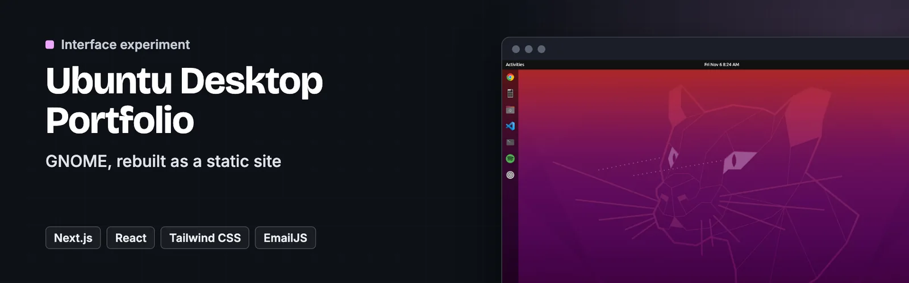
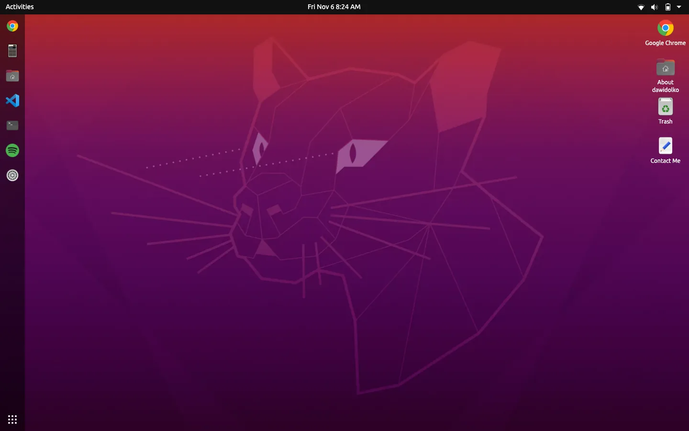
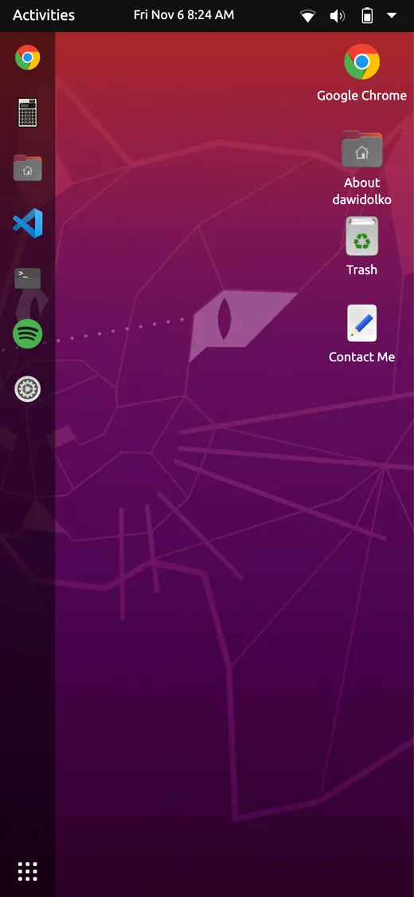

<p align="center">
  <a href="https://ubuntu.dawidolko.pl/"></a>
</p>

# Ubuntu Desktop Portfolio

> 🟠 **GNOME, rebuilt as a static site** — Ubuntu 20.04 recreated in Next.js and Tailwind, with the applications defined in a config file

**Based on [vivek9patel.github.io](https://github.com/vivek9patel/vivek9patel.github.io) by [Vivek Patel](https://github.com/vivek9patel), MIT licence.** `components/apps/dawidolko.js` is his `vivek.js`, renamed and edited. Not affiliated with Canonical or Ubuntu; this is an interface imitation for portfolio purposes.

A portfolio shaped like Ubuntu 20.04: the dock down the left, draggable windows, the dark-orange palette and the GNOME behaviours that go with them.

The part worth stealing is `apps.config.js` — every application on the desktop is an entry in one file, with its icon, its title and the component that renders it. Adding a window to the desktop means adding an object, not wiring a component into three places.


**[Live site](https://ubuntu.dawidolko.pl/)** · [Screenshots](#️-screenshots) · [Getting started](#-getting-started)

---

## 🎯 Key Features

- **Applications defined in one config** — `apps.config.js` lists every window: icon, title, whether it opens on boot, and the component behind it. The desktop reads that list rather than hard-coding a menu.
- **A GNOME dock and window behaviour** — launch, focus, minimise and close, with the dock reflecting what is open.
- **Static export** — `next export` produces plain files, so the whole desktop is hosted free on GitHub Pages.
- **A contact form without a backend** — EmailJS posts directly from the browser.
- **A working calculator** — `expr-eval` parses the expression, so the app computes rather than pretends.
- **Context menus** — right-click behaves as it does on the real desktop.
- **SEO and PWA ready** — meta components and a manifest ship with it.

---

## 🖼️ Screenshots

<p align="center">
  
  
</p>

---

## 🛠️ Technology Stack

| Technology | Version | Role |
| --- | --- | --- |
| **Next.js** | 13 | Rendering and static export. |
| **React** | 18 | The desktop and its applications. |
| **Tailwind CSS** | 3 | Utility-first styling of the GNOME shell. |
| **expr-eval** | 2 | Expression parsing in the calculator. |
| **EmailJS** | 3.10 | The contact form. |
| **jQuery** | 3.6 | A few legacy interactions. |

---

## 🚀 Getting Started

### Prerequisites

- Node.js 16 or newer
- npm

### 1. Clone the repository

```bash
git clone https://github.com/dawidolko/Ubuntu-Simulaing-System-GUI.git
cd Ubuntu-Simulaing-System-GUI
```

### 2. Install dependencies

```bash
npm install
```

### 3. Run

```bash
npm run dev      # development server at http://localhost:3000
npm run build    # production build
npm run export   # static export for GitHub Pages
```

---

## 📁 Project Structure

```
Ubuntu-Simulaing-System-GUI/
├── apps.config.js       # every desktop application, in one list
├── components/
│   ├── screen/          # desktop, lock screen, boot
│   ├── base/            # window chrome, dock, top bar
│   ├── apps/            # the applications themselves
│   ├── context menus/   # right-click behaviour
│   ├── util components/ # shared pieces
│   └── SEO/             # meta tags
├── images/  files/      # icons, wallpapers, in-app content
└── _next/               # the exported build
```

---

## 🖥️ The Family

This is one of four desktop-simulator portfolios, each built on a different stack:

| Desktop | Stack | Live |
| ------- | ----- | ---- |
| Windows 10 | React + Fluent UI | [windows.dawidolko.pl](https://windows.dawidolko.pl) |
| Ubuntu 20.04 | Next.js + Tailwind CSS | [ubuntu.dawidolko.pl](https://ubuntu.dawidolko.pl) |
| macOS | React + TypeScript + Vite | [macos.dawidolko.pl](https://macos.dawidolko.pl) |
| Deepin Linux | Vue 2 + Vuetify | [linux.dawidolko.pl](https://linux.dawidolko.pl) |

---

## ♿ Accessibility

An accessibility panel in the corner of every page changes text size, contrast, font and motion, and remembers the choice on the device. It sits on top of the markup and does not replace accessible markup.

---

## 📄 License

MIT. Copyright (c) 2020 [vivek9patel](https://github.com/vivek9patel) and Copyright (c) 2024 [Dawid Olko](https://dawidolko.pl), see [LICENSE](LICENSE). Fonts, icons and images keep their own terms, listed in [CREDITS.md](CREDITS.md).

---

## 👨‍💻 Author

**Dawid Olko** · Fullstack / AI Developer

[Portfolio](https://olkodawid.dawidolko.pl) · [CV](https://cv.dawidolko.pl) · [LinkedIn](https://www.linkedin.com/in/dawidolko/) · [GitHub](https://github.com/dawidolko)
